# Build log: Pico Gameboy

The RP2040's dual-core ARM Cortex-M0+ makes it capable of running light emulators, so I'm building a
small handheld game console around the RP2040 that can run Game Boy games.

I posted these as devlogs on [Hack Club Flavortown](https://flavortown.hackclub.com/projects/11456) while building the project: 18 entries and 31 h 34 min of logged work, 5 Feb 2026 to 26 Apr 2026. The text is lightly edited for spelling and clarity; dates are UTC.

| # | Date | Logged | Entry |
|---|---|---|---|
| 1 | 5 Feb 2026 | 47 min | [Wiring up the screen](#1--wiring-up-the-screen) |
| 2 | 12 Feb 2026 | 2 h 9 min | [Prototype finished](#2--prototype-finished) |
| 3 | 16 Feb 2026 | 1 h 40 min | [Console schematic, roughly done](#3--console-schematic-roughly-done) |
| 4 | 16 Feb 2026 | 1 h 39 min | [SD card over SPI](#4--sd-card-over-spi) |
| 5 | 20 Feb 2026 | 1 h 40 min | [Schematic finished](#5--schematic-finished) |
| 6 | 22 Feb 2026 | 1 h 33 min | [Footprints, and starting to route](#6--footprints-and-starting-to-route) |
| 7 | 22 Feb 2026 | 1 h 28 min | [SD module mismatch](#7--sd-module-mismatch) |
| 8 | 1 Mar 2026 | 2 h 5 min | [Most parts placed](#8--most-parts-placed) |
| 9 | 7 Mar 2026 | 2 h 28 min | [Routing the main sections](#9--routing-the-main-sections) |
| 10 | 7 Mar 2026 | 1 h 10 min | [Ten traces left](#10--ten-traces-left) |
| 11 | 7 Mar 2026 | 1 h 1 min | [Routing finished](#11--routing-finished) |
| 12 | 7 Mar 2026 | 1 h 33 min | [Ordering the PCB](#12--ordering-the-pcb) |
| 13 | 17 Mar 2026 | 44 min | [A rendered demo](#13--a-rendered-demo) |
| 14 | 23 Mar 2026 | 1 h 48 min | [The board arrived](#14--the-board-arrived) |
| 15 | 1 Apr 2026 | 1 h 28 min | [Ditching the RT6154A](#15--ditching-the-rt6154a) |
| 16 | 6 Apr 2026 | 2 h 59 min | [Power island (again), audio and battery](#16--power-island-again-audio-and-battery) |
| 17 | 25 Apr 2026 | 2 h 18 min | [Reflow attempt 2](#17--reflow-attempt-2) |
| 18 | 26 Apr 2026 | 3 h 4 min | [Final stage: Kirby runs](#18--final-stage-kirby-runs) |

---

## 1 · Wiring up the screen
5 Feb 2026 · 47 min logged

Spent some time roughly wiring up the screen, though it doesn't work yet (probably because I haven't
soldered the pins).

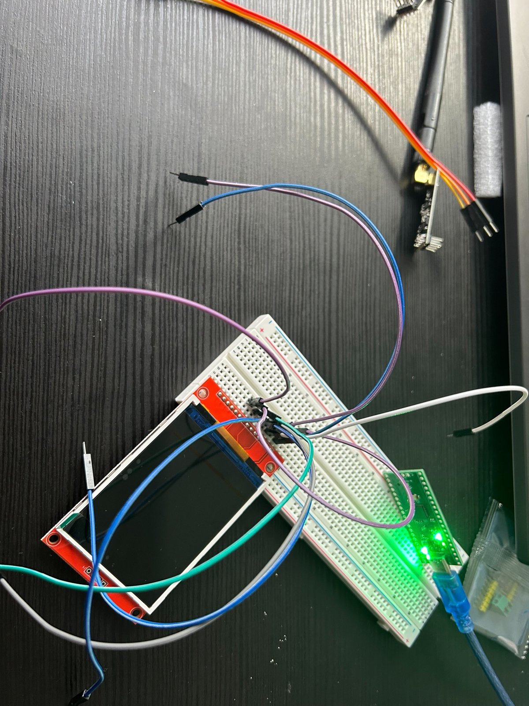

---

## 2 · Prototype finished
12 Feb 2026 · 2 h 9 min logged

After two hours of struggle, I finished the prototype:

- The SD card breakout is connected and running (with Pokémon Red stored on it).
- The screen can display what's on the SD card.
- Pressing button A (GPIO 7) enters the game.

▶ [Video (6.1 MB)](media/21686-1.mp4)

---

## 3 · Console schematic, roughly done
16 Feb 2026 · 1 h 40 min logged

Roughly finished the schematic for the console:

- RP2040
- USB-C and an RT6154AGQW
- LCD screen

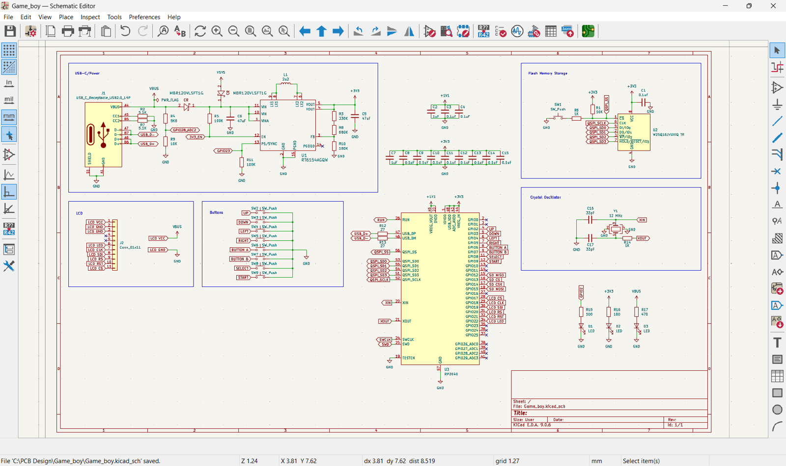

---

## 4 · SD card over SPI
16 Feb 2026 · 1 h 39 min logged

Worked on the SD card schematic and learned how SD maps onto SPI, so my RP2040 can read games from
the card. I didn't even know there was a translation between SD and SPI, so it took a lot of time to
work out.

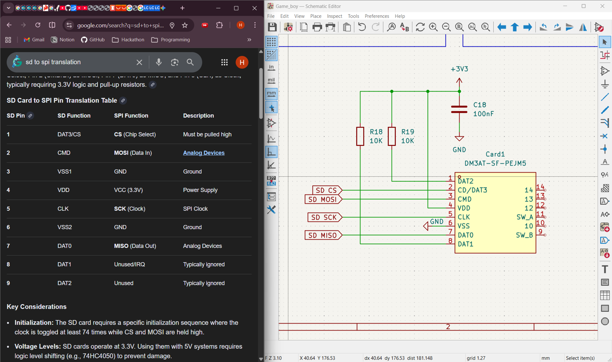

---

## 5 · Schematic finished
20 Feb 2026 · 1 h 40 min logged

Finally finished the schematic. Changes I made:

- Upgraded the flash from 2 MB to 16 MB.
- Pulled up every SD card pin.
- Removed the external power-supply cluster.

I'll add a battery in V2; for now the focus is the core functionality.

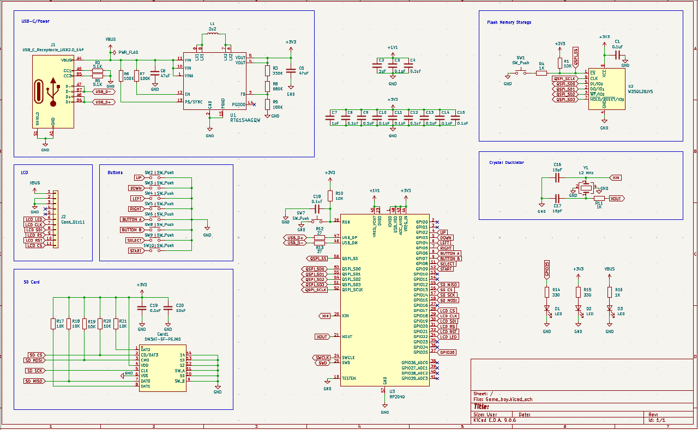

---

## 6 · Footprints, and starting to route
22 Feb 2026 · 1 h 33 min logged

Assigned footprints and started routing the PCB. Since this is the very first prototype, I'll use the
screen module and very simple buttons. I also decided to go with the 16 MB flash, just in case.

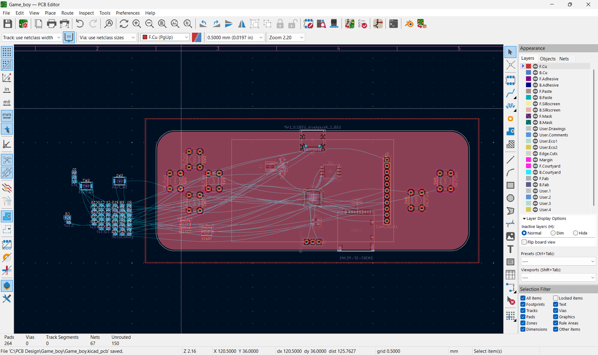

---

## 7 · SD module mismatch
22 Feb 2026 · 1 h 28 min logged

This is getting frustrating: how does my SD card module not match the ones on GitHub?

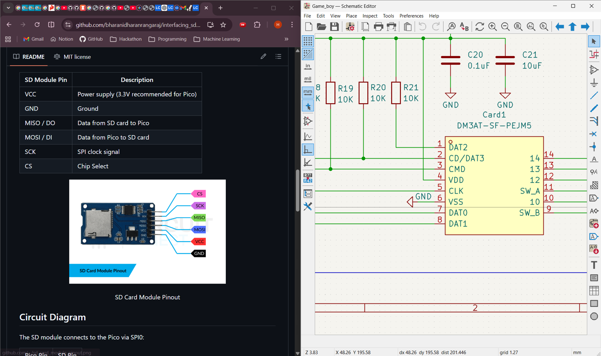

---

## 8 · Most parts placed
1 Mar 2026 · 2 h 5 min logged

Big progress: I sat down for two hours and got a lot done.

- **Placed most parts.** Almost everything is on the board, apart from some of the tiny resistors and
  capacitors; my brain was too fried to squeeze them in, so they can wait.
- **Replaced the BOOTSEL and reset buttons with a connector.** Taking them off the main board saves a
  lot of space and routing trouble.
- **Added pull-up resistors and capacitors.** All the necessary pull-ups and decoupling capacitors,
  so the signals stay stable and the RP2040 doesn't randomly drop its connection like last time.

I can see the light at the end of the tunnel: just the last few tiny components to place.

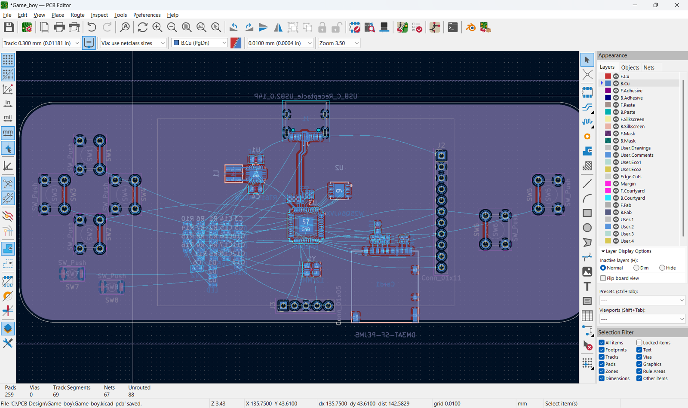

---

## 9 · Routing the main sections
7 Mar 2026 · 2 h 28 min logged

Serious progress tonight: I locked in and finished routing several of the main sections.

- **Flash.** Routed every line between the RP2040 and the flash chip, keeping the traces as short and
  clean as possible so BOOTSEL works this time and reads don't drop.
- **Power supply.** Finally got the power section fully routed with the new RT6150B setup. I
  double-checked the copper pours and the 3V3 and 5V lines, so hopefully no more short circuits and
  blown regulators.
- **Buttons (except Start and Select).** The D-pad and A/B buttons are wired and placed. I skipped
  Start and Select for now, because I couldn't yet find room for them without disturbing other
  traces.
- **SD card.** Finished routing the new, cheaper TF card slot, with the large 3.3 V plane underneath
  it. It should be very stable for loading games now.

Nearly done with this board: just those last two buttons.

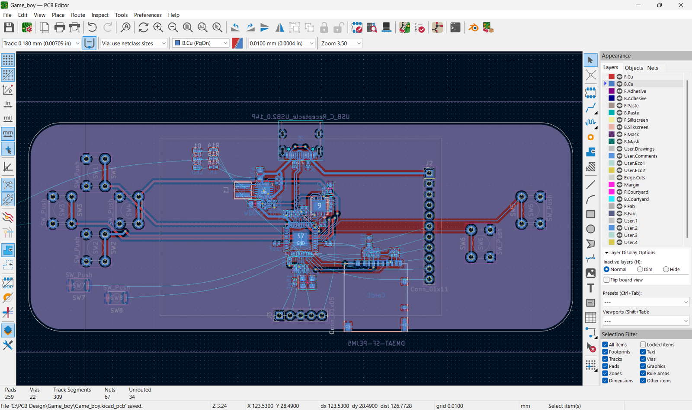

---

## 10 · Ten traces left
7 Mar 2026 · 1 h 10 min logged

Almost done routing the whole PCB; only about 10 traces left. I also removed the RUN pin and button
entirely, since I don't mind unplugging the console to reset it, and it saves a lot of space and
routing trouble. Just the last few lines in KiCad and we're good to go.

▶ [Video (15.6 MB)](media/28805-1.webm)

---

## 11 · Routing finished
7 Mar 2026 · 1 h 1 min logged

Finally routed everything. Time for a big clean-up, then export the Gerbers and order.

- **RP2040 cluster.** Routed all the MCU traces, making sure the decoupling capacitors are close
  enough this time so the chip doesn't randomly die.
- **SD card.** Finished the SD card slot lines with the new 3.3 V plane; it should load games
  without dropping the connection.
- **Screen pin holes.** Placed all the through-holes for the display so it sits flush on the board.
- **Every button from the original Game Boy.** D-pad, A, B, Start and Select. Routing the pads wasn't
  bad, but getting the placement right so it feels like a proper handheld took forever.

One last DRC run in KiCad to check for shorts, then off to fab. Fingers crossed I didn't mess up any
footprints again.

▶ [Video (8.8 MB)](media/28845-1.mp4)

---

## 12 · Ordering the PCB
7 Mar 2026 · 1 h 33 min logged

Time to order the PCB. This time I went with a double-sided board, keeping the stencils as small as
possible so they don't take over my desk. Oddly, getting both top and bottom stencils didn't cost any
more than the top alone, so I got both. I've also added all the components to my cart, ready to
order; hopefully I didn't forget any little resistors. Here's hoping everything works when it
arrives, without another four-hour reflow debugging session.

▶ [Video (15.6 MB)](media/29101-1.mp4)

---

## 13 · A rendered demo
17 Mar 2026 · 44 min logged

Rendered this demo. The PCB itself looks a bit rough, so I rendered the demo myself. I also published
the files to GitHub; I hope you like it.

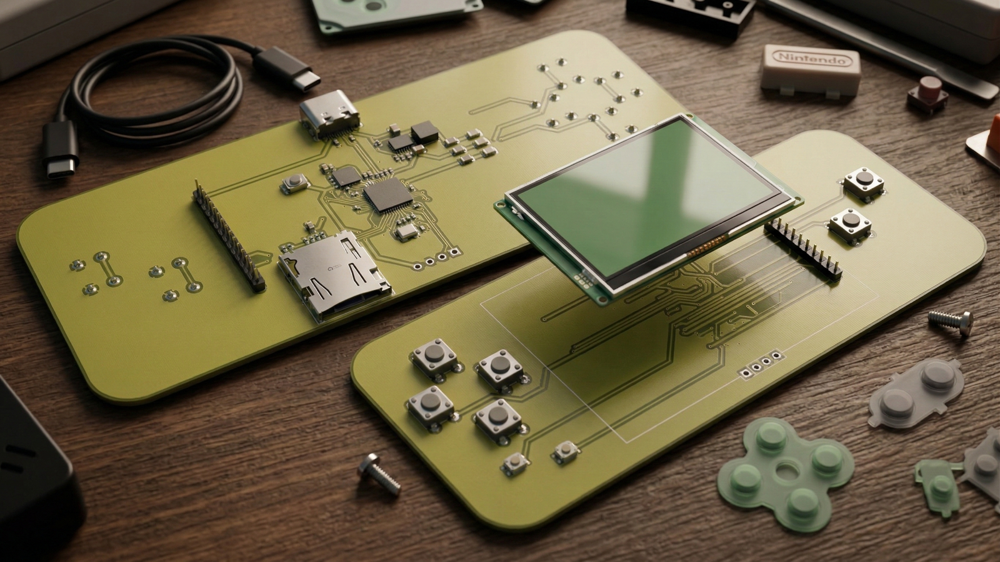

---

## 14 · The board arrived
23 Mar 2026 · 1 h 48 min logged

Finally got the board. I reflowed it (my second time reflowing SMD parts), and it went well until I
found the board wouldn't transfer data. I suspect two causes:

- **Design:** I used 330K + 680K for the RT6154AGQW feedback divider instead of a proper 1.02M.
- **Reflow:** I accidentally peeled off one of the RT6154AGQW's output capacitors, which could cause
  more voltage spikes on 3.3 V.

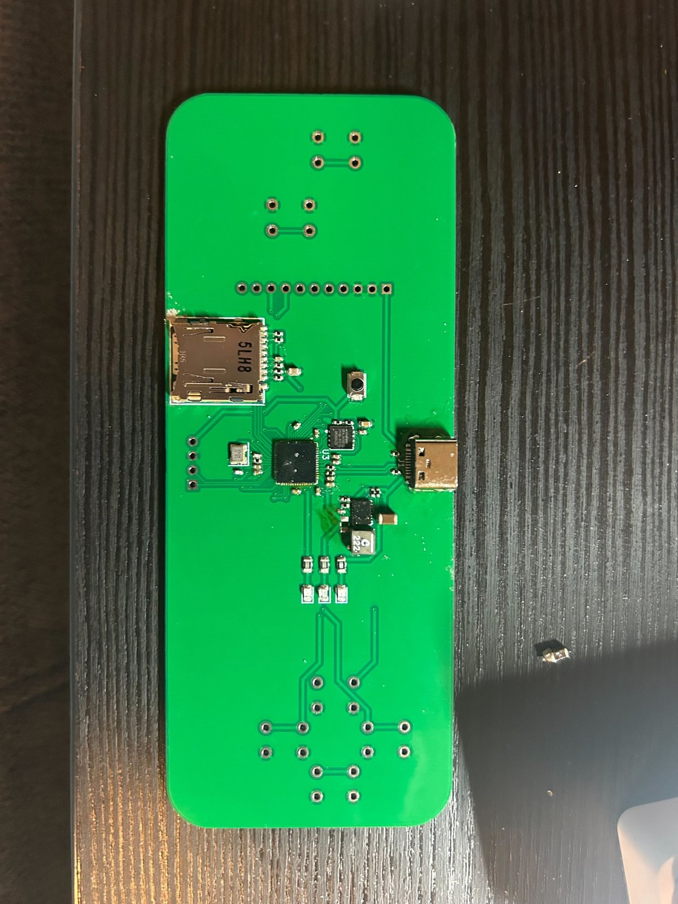

---

## 15 · Ditching the RT6154A
1 Apr 2026 · 1 h 28 min logged

Spent today ripping up the board again. I finally ditched the RT6154A for the RT6150B, because I'm
done with it, and rerouted a lot, especially the power supply (yes, again). I also replaced the TF
card slot with a much cheaper one; the old one was overpriced for what it is. And I added a large
3.3 V copper plane under the TF socket for a more stable supply, since we don't want the SD card
dropping out while loading.

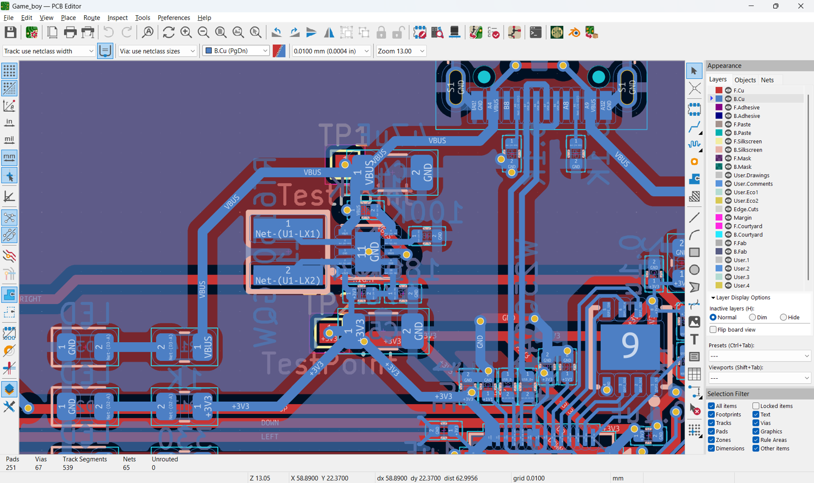

---

## 16 · Power island (again), audio and battery
6 Apr 2026 · 2 h 59 min logged

Three hours? I looked at the clock and couldn't believe it; PCB routing is a time machine. What I got
done:

- **Fixing the power island, again.** This is officially the fifth or sixth time I've ripped up and
  redone the power island (see the image). After the 5 V and 3V3 lines shorted and fried my
  regulators in the last reflow attempt, I'm taking no chances. I redid the traces, made sure the GND
  and VCC pours aren't doing anything sketchy, and optimised the placement so power to the RP2040 and
  the flash is stable this time. I see these traces in my sleep now.
- **Audio (MAX98357A).** Finally got to the audio side. I hooked up the MAX98357A class-D amp on a
  breadboard prototype. Since it takes I2S, I had to make sure the data, bit-clock and word-select
  lines from the MCU behaved. It's great seeing (and hearing) it process digital audio without much
  static.
- **Battery and charging circuit.** Added the battery and charging IC to the schematic so this can be
  a proper portable device. I double-checked the load sharing so the board doesn't draw from the
  battery while plugged in over USB-C (really trying not to blow up another USB port or regulator).

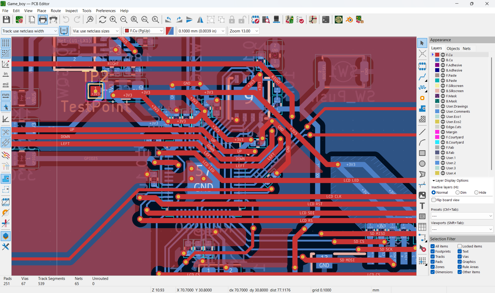

---

## 17 · Reflow attempt 2
25 Apr 2026 · 2 h 18 min logged

I forgot that I had put all my ICs on the back, and I hadn't ordered a stencil to match the back, so
the stencil was useless. I reflowed the board anyway with my rough hand-pasting, and it works.

Before powering up for the first time, I found with my multimeter that 5 V and 0 V were shorted,
which I was very glad to catch. I hot-aired the RT6150B and that fixed the short, a huge win. I
tested 5 V, 3V3 and 0 V again, and as expected both power indicators came on and the board talked to
my computer. I uploaded a random UF2 file to test it, and it worked well.

To be safe, I loaded MicroPython and tested every GPIO pin, and more importantly the SD card slot. At
first it didn't work and I thought I'd failed, but then it did: it could read and write my SD card,
which was huge. Finally, after confirming every GPIO switched as expected, I soldered on the screen
module and all the buttons. I still have to sort out the software for the console, but we'll see how
it goes.

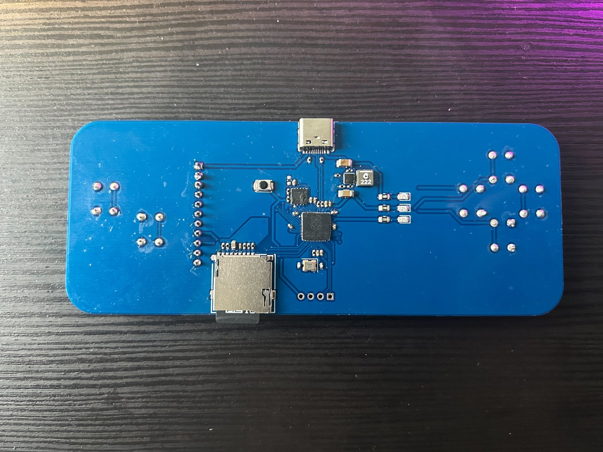

---

## 18 · Final stage: Kirby runs
26 Apr 2026 · 3 h 4 min logged

After reflowing the board and roughly validating the GPIOs, it was time to see whether the SD card
and the screen could talk to the RP2040.

- I had already tested reading and writing the SD card, so I wasn't too worried (actually I was a
  little, because it sometimes didn't detect the card).
- Next was the screen. I tested every screen-module pin with a loop toggling them on and off,
  measuring each one with my multimeter. I debated using a pin socket to plug the screen in versus
  soldering it directly.
- I decided to solder it directly, because I was confident: every GPIO worked and the SD card was
  reading, so I didn't see much chance of failure.
- The funny part: after soldering it and loading the emulator, I found the screen was upside down. I
  hadn't noticed during prototyping.
- That wasn't going to stop me, since it was clearly fixable in software. I dug into the code and
  found where it sets the starting point for screen updates. It started from the top, so I changed
  it to start at the bottom and finish at the top.

And the game ran flawlessly. Being able to pick any game and play it was the best moment. Check out
Kirby running on it.

Hopefully this is the last devlog.

▶ [Video (4.0 MB)](media/44116-1.mp4)
